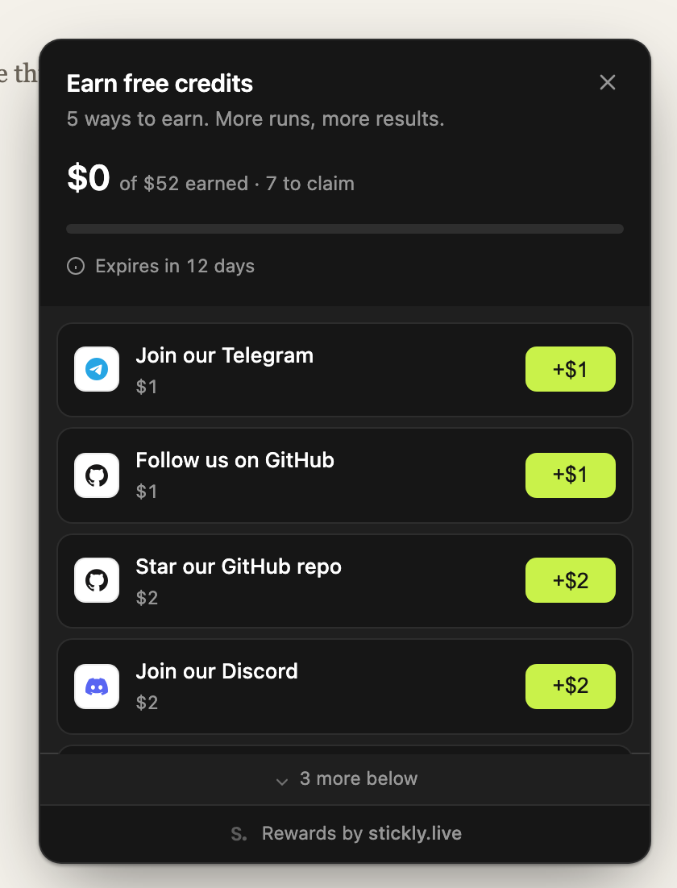
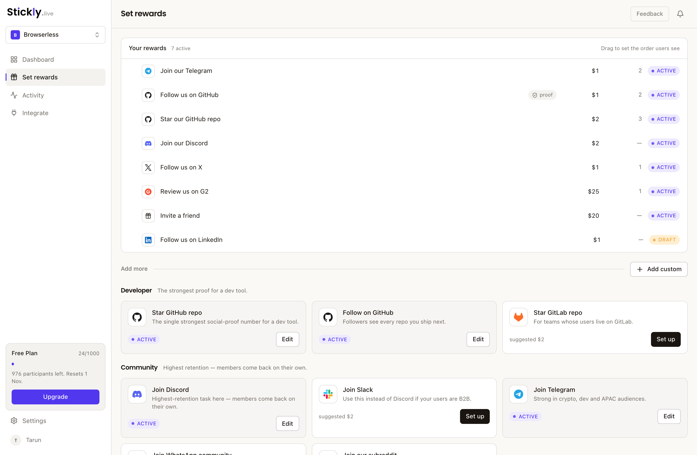
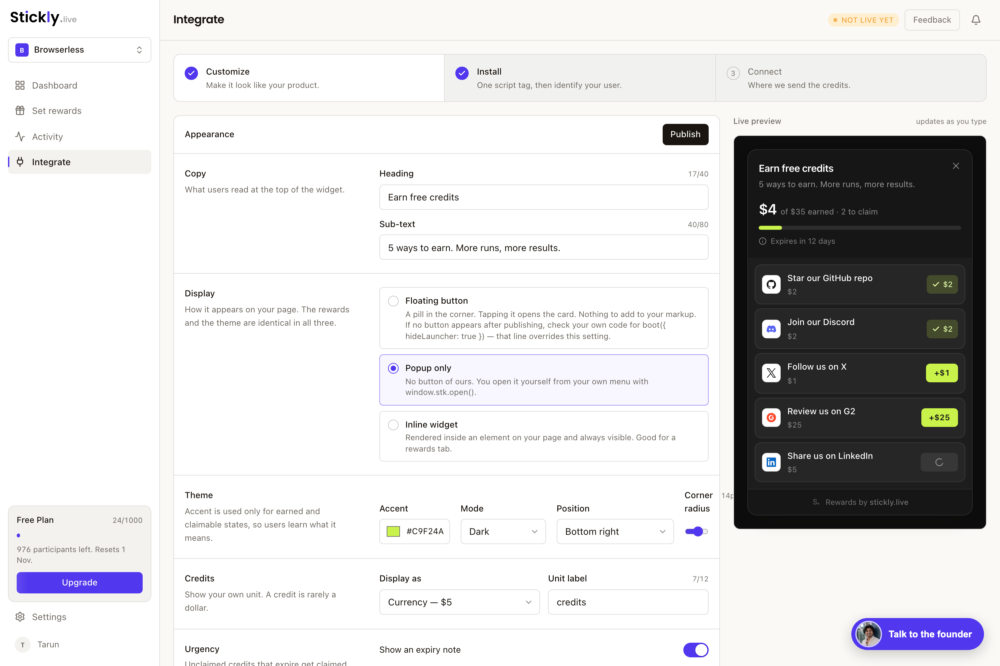
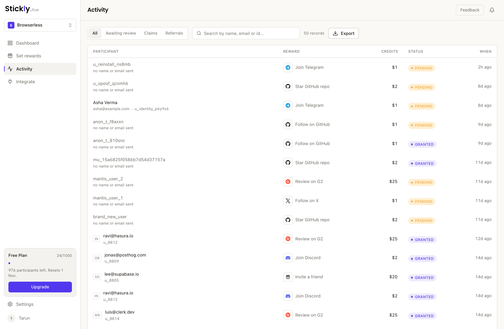
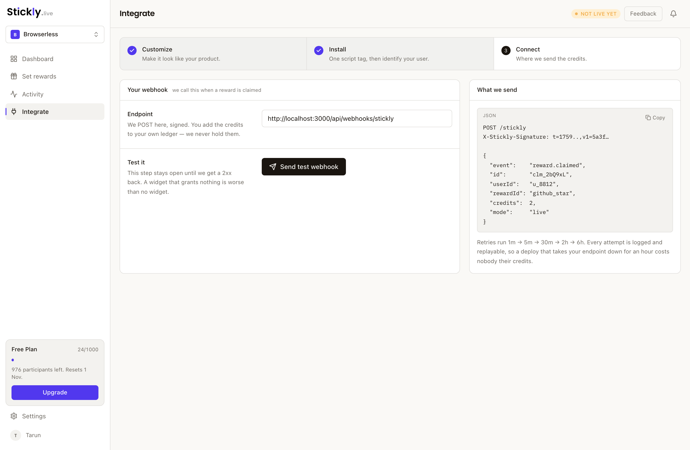

<div align="center">

# Stickly

**Drop-in rewards widget for SaaS.** Let your users earn *your own product credits*
for starring your repo, joining your Discord, or leaving a G2 review — one script
tag, rewards granted by signed webhook to your own ledger.

[](./LICENSE)
[](https://www.npmjs.com/package/@stickly/node)
[](./packages/widget)

[stickly.live](https://stickly.live) · [Get a free key](https://app.stickly.live) · [Integration guide for agents](./AGENTS.md)



</div>

---

## What it is

Your users already like your product. Stickly gives them a short list of things
they could do for you — follow, star, join, review, refer — and pays them in the
currency you already have: **your own credits**.

Stickly never holds the credits. It tells you a task was claimed; you add the
credits to your own ledger. One script tag on your side, one webhook endpoint,
and a dashboard where someone who is not an engineer can change the rewards
without a deploy.

```
your user clicks a reward  →  Stickly records the claim
                           →  signed webhook to your server
                           →  you credit your own ledger
```

## Install

**One script tag.** That is the whole client install.

```html
<script src="https://cdn.stickly.live/w.js" data-key="pk_live_…" async></script>
```

Then tell Stickly which of your users it is talking to, with a token you sign on
your server:

```ts
import { signUserToken } from '@stickly/node';

// server — an endpoint only a signed-in user can reach
const token = signUserToken({ sub: user.opaqueId }, process.env.STICKLY_SIGNING_SECRET!);
```

```js
// browser — once the signed-in user is known
window.stk = window.stk || { cmd: [] };
window.stk.cmd.push(s => s.boot({ key: 'pk_live_…', token }));
```

And grant the credits when the webhook arrives:

```ts
import { verifyWebhook, shouldGrant } from '@stickly/node';

export async function POST(req: Request) {
  const raw = await req.text();                       // raw bytes, not a parsed object
  const event = verifyWebhook(raw, req.headers.get('x-stickly-signature'),
                              process.env.STICKLY_WEBHOOK_SECRET!);

  if (shouldGrant(event)) {
    await grantCredits(event.userId, event.credits, { idempotencyKey: event.id });
  }
  return Response.json({ ok: true });                 // 200 even when you ignore it
}
```

Get your keys at **[app.stickly.live](https://app.stickly.live)** — free tier, no card.

## What your users can do to earn

Twenty-six built-in rewards across twenty-two platforms, and any URL you like on
top of them.

| | |
|---|---|
| **Reviews & listings** | G2 · Capterra · Trustpilot · Google · Product Hunt · Play Store · App Store · Chrome Web Store |
| **Community** | Discord · Slack · Telegram · WhatsApp · Reddit |
| **Developer** | Star a GitHub repo · Follow on GitHub · Star a GitLab repo |
| **Social** | X · LinkedIn · YouTube · Instagram · TikTok · Facebook |
| **Share** | Post to X, LinkedIn or Reddit with copy you write |
| **Referral** | Invite a friend, tracked through to signup |

Anything else is just a URL: paste it, Stickly reads the domain for the icon and
the button label, and it behaves like the rest.

> **Stickly does not verify that a task was done.** There is no scraping, no API
> check, no automation. The user says they did it and you decide whether to trust
> that. Rewards can require a **link or a screenshot as proof**, which holds the
> credits until you approve the claim in Activity.
>
> Check each platform's own terms before you reward an action on it — some of
> them prohibit incentives, and that is your call to make, not ours to hide.

## Why not just build this yourself?

The widget is the easy part. A list of links with a `localStorage` flag is an
afternoon's work, and if that is genuinely all you need, build it — you do not
need us.

What takes weeks is everything behind it:

- **Identity.** The user id has to come from a token you sign on your server,
  never from the browser. Read it from the request body and anyone can mint
  credits in a console loop. The signing secret has to be per-key, not shared,
  or one tenant can sign for another.
- **Delivery.** Signed webhooks with a timestamp tolerance, a constant-time
  comparison, and verification over the **raw bytes** — re-serialise the body
  before checking and every signature breaks. Then retries on a backoff,
  idempotency keyed on the event id so a retry cannot grant twice, and a worker
  that actually runs. We shipped that queue once with nothing calling it; it
  took a lost grant and a log dig to notice.
- **Isolation.** Shadow DOM, so the host page's CSS cannot reach in and yours
  cannot reach out. 16 kB gzipped, CSP documented, cross-origin — including the
  trap where `navigator.sendBeacon` silently drops every event because it sends
  credentials and the reply is `Access-Control-Allow-Origin: *`.
- **A dashboard.** Somebody who is not you needs to change the copy, the rewards
  and the credit amounts without waiting for a deploy.

None of that is hard. All of it is a week you did not plan for, and most of it
fails silently when you get it wrong.

## Script tag or npm package?

Both install the same widget. The script tag is the default.

| | `<script>` tag | `@stickly/widget` |
|---|---|---|
| Install | one line of HTML | `npm i`, then import |
| Updates | automatic, from the CDN | pinned to your deploy |
| Types | — | TypeScript types |
| SSR | always safe | guard the init in Next/Remix |
| Use it when | almost always | you must pin a version, or your CSP forbids third-party scripts |

## The dashboard

Rewards, credit values and ordering — changed without a deploy.



Appearance, display mode and position, with a live preview.



Every claim, with the proof queue for rewards that ask for it.



The webhook contract, and the test button that proves your endpoint answers.



## The webhook

`POST` to your endpoint, signed with `X-Stickly-Signature: t=<unix>,v1=<hex>`,
where `v1 = HMAC_SHA256("<t>.<rawBody>", STICKLY_WEBHOOK_SECRET)`.

```json
{
  "event": "reward.claimed",
  "id": "clm_2bQ9xL",
  "userId": "u_8812",
  "rewardId": "github_star",
  "credits": 2,
  "mode": "live"
}
```

- **`id` is your idempotency key.** Retries run 1m → 5m → 30m → 2h → 6h.
- **Return `200` even when you ignore a delivery.** A non-2xx is retried for six
  hours and an unknown user will still be unknown at the end of them.
- **Ignore `mode: "test"` in production.** Test keys skip identity verification,
  so that `userId` is whatever the browser said it was.

`@stickly/node` does the verification, the tolerance and the constant-time
compare for you, and `shouldGrant()` covers the last rule.

## Packages

| Package | What it is |
|---|---|
| [`@stickly/node`](./packages/node) | Webhook verification and token signing. Zero dependencies, ESM + CJS, typed. |
| [`@stickly/widget`](./packages/widget) | The widget bundle itself — Preact in a shadow root, 16 kB gzip. |

## Security

- Secrets are **server-side only**. `STICKLY_SIGNING_SECRET` and
  `STICKLY_WEBHOOK_SECRET` must never reach browser code; only
  `STICKLY_PUBLIC_KEY` is safe there.
- Put an **opaque id** in the token's `sub`. It is sent to a third party, it is
  readable in a JWT the browser holds, and it comes back in every webhook. If
  your primary key is an email address, map it to something else first.
- `name` and `email` are **optional** and display-only. They must travel in the
  signed token, never in `boot()` — otherwise any user could type a colleague's
  address into a console and have it appear beside their claim.
- Found something? Please email **hello@stickly.live** rather than opening a
  public issue.

## Contributing

Issues and pull requests are welcome on the widget and the SDK.

The hosted service — key issuance, the claim endpoint, webhook delivery and the
dashboard — is closed source and is not in this repository. That is the honest
shape of it: the client is yours to read, fork and pin; the service is what you
get a key for.

## License

MIT — see [LICENSE](./LICENSE).
